## Overview

Edge Serial helps you send and receive serial data in MakeCode projects using simple, visual blocks.

This page is designed for beginners. Start in the blocks guide, then use TypeScript docs if you need advanced control.

## What you can build

- Debug consoles and telemetry streams
- Board-to-board command channels
- Host tools that parse line-based serial messages
- Classroom experiments with serial protocols

## Learning path

- Start with blocks: [Edge Serial Blocks Guide](blocks/)
- Use TypeScript when ready: [Edge Serial TypeScript Reference](typescript/)
- Browse the full API structure: [Edge Serial API Index](api/)

## Examples

::: view-switch

<x-example>
<div>

### Send data

Connect serial to pins P0 (TX) and P1 (RX) at 115200 baud, then send a line of text and a named value whenever button A is pressed.

</div>
<div>

::: blocks
<x-photo>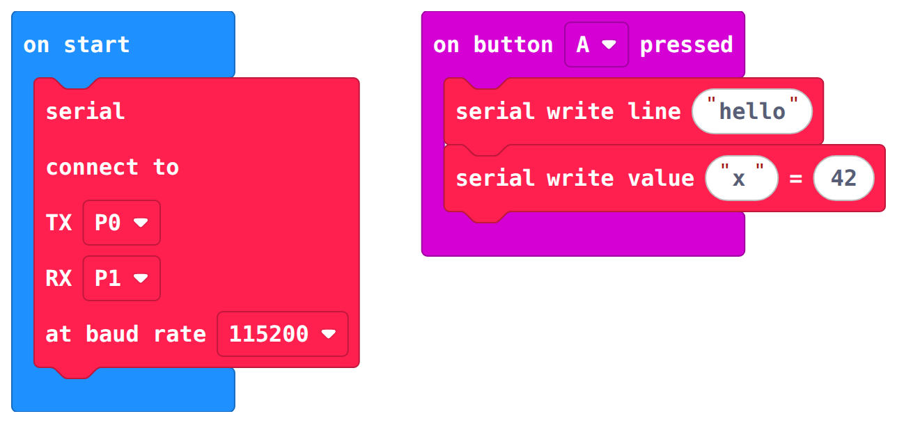</x-photo>
:::

::: typescript
```typescript
edgeserial.redirect( EdgeSerialPin.P0, EdgeSerialPin.P1, EdgeBaudRate.BaudRate115200 )
input.onButtonPressed( Button.A, function () {
    edgeserial.writeLine( "hello" )
    edgeserial.writeValue( "x", 42 )
} )
```
:::

</div>
</x-example>

<x-example>
<div>

### Receive data

Run some blocks every time a complete line arrives, and show what was received.

</div>
<div>

::: blocks
<x-photo>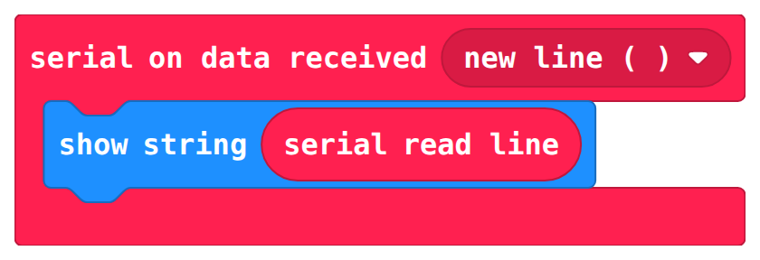</x-photo>
:::

::: typescript
```typescript
edgeserial.onDataReceived( edgeserial.delimiters( Delimiters.NewLine ), function () {
    basic.showString( edgeserial.readLine() )
} )
```
:::

</div>
</x-example>

## Block reference

| Block | What it does |
| --- | --- |
| :blocks[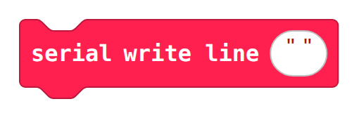] :typescript[`edgeserial.writeLine( text )`] | Sends a line of text, followed by a new line. |
| :blocks[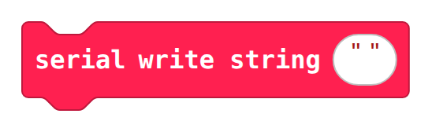] :typescript[`edgeserial.writeString( data )`] | Sends text exactly as given, with no new line. |
| :blocks[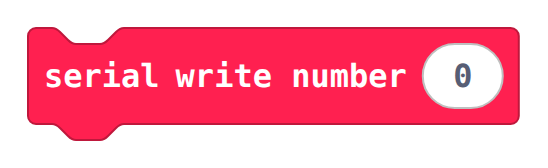] :typescript[`edgeserial.writeNumber( value )`] | Sends a number as text. |
| :blocks[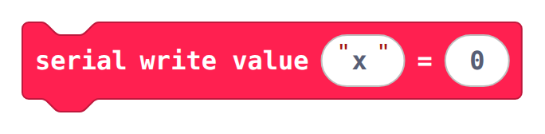] :typescript[`edgeserial.writeValue( name, value )`] | Sends a named value, as `name:value`. |
| :blocks[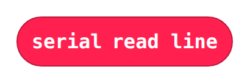] :typescript[`edgeserial.readLine()`] | Reads one line of received text. |
| :blocks[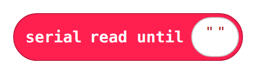] :typescript[`edgeserial.readUntil( delimiter )`] | Reads received text up to the chosen delimiter. |
| :blocks[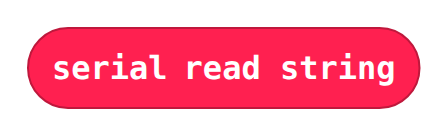] :typescript[`edgeserial.readString()`] | Reads everything currently waiting in the receive buffer as text. |
| :blocks[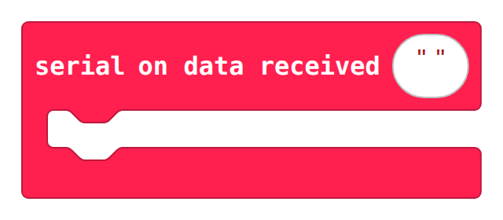] :typescript[`edgeserial.onDataReceived( delimiters, body )`] | Runs your blocks whenever data ending in the chosen delimiter arrives. |
| :blocks[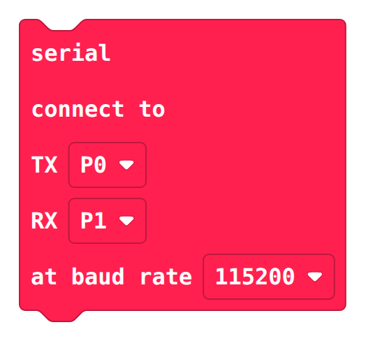] :typescript[`edgeserial.redirect( tx, rx, rate )`] | Moves serial to the chosen TX and RX pins and baud rate. |

### Advanced blocks

These are found under **Advanced** in the Edge Serial drawer, and most projects will not need them.

| Block | What it does |
| --- | --- |
| :blocks[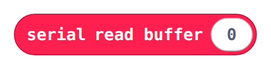] :typescript[`edgeserial.readBuffer( length )`] | Reads raw bytes from the receive buffer. |
| :blocks[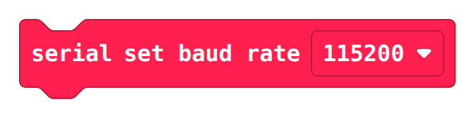] :typescript[`edgeserial.setBaudRate( rate )`] | Changes the baud rate without changing the pins. |
| :blocks[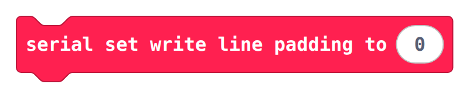] :typescript[`edgeserial.setWriteLinePadding( length )`] | Sets how many bytes each written line is padded to. |
| :blocks[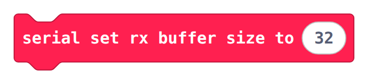] :typescript[`edgeserial.setRxBufferSize( size )`] | Sets the size of the receive buffer. |
| :blocks[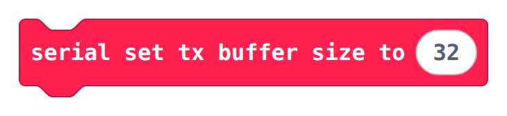] :typescript[`edgeserial.setTxBufferSize( size )`] | Sets the size of the transmit buffer. |

`edgeserial.writeNumbers( values )` sends an array of numbers separated by commas. It is available in TypeScript only.

## More resources

- TypeScript namespace docs: [Edge Serial Namespace](namespace_edgeserial/)
- TypeScript enum docs: [Edge Serial Pin Enum](enum_edgeserialpin/), [Edge Baud Rate Enum](enum_edgebaudrate/)
